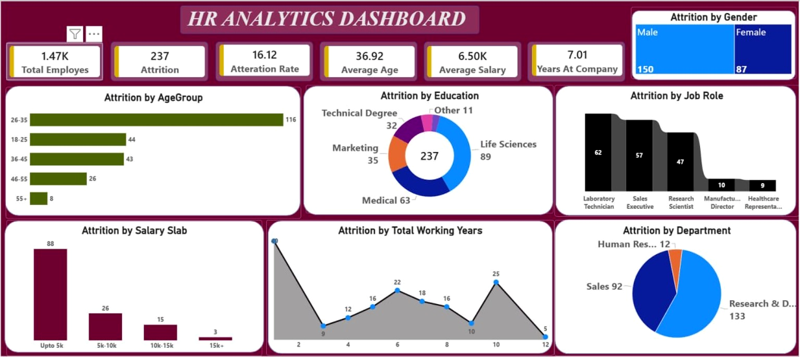

<div align="center">

# 👥 HR Analytics Dashboard | Power BI

**Transforming HR Data into Actionable Workforce & Employee Attrition Insights**

[](https://powerbi.microsoft.com/)

[](https://learn.microsoft.com/power-query/)

[](https://powerbi.microsoft.com/)

</div>

---

## 📌 Project Overview

This project presents an interactive **HR Analytics Dashboard** developed using Microsoft Power BI. It focuses on analyzing employee attrition and workforce-related metrics to understand employee turnover patterns across different demographics and organizational categories.

The dashboard provides insights into employee distribution, attrition rates, average salary, employee age, working experience, education, job roles, and departments.

It helps HR professionals identify attrition patterns, monitor workforce performance, and make informed, data-driven decisions.

> **Project Focus:** HR Analytics • Employee Attrition • Workforce Analysis • Data Transformation • Business Intelligence • Data Visualization

## 📸 Dashboard Preview



---

## 🎯 Project Objectives

- Analyze overall employee attrition and workforce statistics.
- Monitor employee attrition rates across different age groups.
- Understand attrition distribution by gender and education field.
- Identify job roles with higher employee attrition.
- Analyze attrition patterns across different salary slabs.
- Explore the relationship between working experience and employee attrition.
- Compare attrition across different organizational departments.
- Generate meaningful HR insights to support workforce planning.

---

# 🔄 Project Workflow — Phase by Phase

## Phase 1 — Data Collection & Understanding

**Goal:** Understand the dataset and identify the key analytical requirements.

- Reviewed the HR dataset and its available columns.
- Identified important employee-related attributes.
- Understood demographic and professional information.
- Identified numerical and categorical fields.
- Defined the key business questions and KPIs for the dashboard.

## Phase 2 — Data Cleaning & Transformation

**Tool:** Power Query

**Goal:** Prepare raw HR data for accurate and meaningful analysis.

- Imported the HR dataset into Power BI.
- Reviewed column names and data types.
- Checked data quality and missing values.
- Identified and handled duplicate records where required.
- Cleaned and transformed data using Power Query.
- Standardized column formats and data types.
- Prepared the dataset for analysis and visualization.

## Phase 3 — Data Modeling

**Tool:** Microsoft Power BI

**Goal:** Organize the transformed data for effective analysis.

- Reviewed the structure of the cleaned dataset.
- Organized employee attributes for reporting.
- Prepared fields for analytical calculations.
- Structured the data for interactive visualizations and filtering.

## Phase 4 — KPI Development & Analysis

**Tool:** Power BI

**Goal:** Develop important HR performance indicators.

The dashboard includes the following KPIs:

- Total Employees
- Total Attrition
- Attrition Rate
- Average Age
- Average Salary
- Average Years at Company

These KPIs provide an overview of workforce statistics and employee attrition performance.

## Phase 5 — Dashboard Design & Visualization

**Tool:** Microsoft Power BI

**Goal:** Transform HR data into an interactive and visually informative dashboard.

The dashboard is divided into the following analytical sections:

### 5.1 Attrition by Gender

- Male employee attrition.
- Female employee attrition.
- Gender-wise attrition comparison.

### 5.2 Attrition by Age Group

- Employee attrition across different age groups.
- Identification of age groups with higher attrition.
- Comparison of employee turnover patterns.

### 5.3 Attrition by Education

- Life Sciences
- Medical
- Marketing
- Technical Degree
- Other

Analyzes employee attrition across different educational backgrounds.

### 5.4 Attrition by Job Role

- Laboratory Technician
- Sales Executive
- Research Scientist
- Manufacturing Director
- Healthcare Representative

Identifies job roles contributing to employee attrition.

### 5.5 Attrition by Salary Slab

- Up to 5K
- 5K–10K
- 10K–15K
- 15K+

Analyzes employee attrition across different salary categories.

### 5.6 Attrition by Total Working Years

- Analyzes attrition across different experience levels.
- Identifies variations in attrition based on total working years.
- Helps understand workforce experience patterns.

### 5.7 Attrition by Department

- Research & Development
- Sales
- Human Resources

Compares employee attrition across different organizational departments.

## Phase 6 — Insights & Business Analysis

**Goal:** Convert dashboard findings into meaningful HR insights.

The dashboard helps identify:

- Age groups experiencing higher employee attrition.
- Gender-wise differences in employee turnover.
- Education fields contributing to higher attrition.
- Job roles with comparatively higher attrition.
- Salary categories associated with higher attrition counts.
- Department-wise employee attrition patterns.
- Attrition trends across different working experience levels.

## Phase 7 — Business Recommendations

Based on the dashboard analysis, organizations can consider:

- Improving employee retention strategies.
- Reviewing compensation and salary structures.
- Identifying employee retention challenges in specific departments.
- Evaluating job satisfaction across different job roles.
- Developing career growth and employee development programs.
- Improving workforce planning and resource allocation.
- Monitoring employee attrition trends regularly.

---

## 📊 Key Dashboard Metrics

| KPI | Value |
|---|---:|
| Total Employees | 1.47K |
| Total Attrition | 237 |
| Attrition Rate | 16.12% |
| Average Age | 36.92 |
| Average Salary | 6.50K |
| Average Years at Company | 7.01 |

## 🔍 Key Insights

- Total employee attrition is 237, with an overall attrition rate of 16.12%.
- The 26–35 age group has the highest attrition count (116).
- Life Sciences has the highest attrition among education categories (89).
- Laboratory Technician has the highest attrition among the displayed job roles (62).
- The Up to 5K salary slab records the highest attrition (88).
- Research & Development has the highest department-wise attrition (133).
- Male employee attrition (150) is higher than female employee attrition (87).

---

## 🧰 Tools & Technologies

| Tool / Technology | Purpose |
|---|---|
| Microsoft Power BI | Dashboard Development & Data Visualization |
| Power Query | Data Cleaning & Transformation |
| Data Analysis | Employee Attrition Analysis |
| Data Modeling | Organizing Data for Analysis |
| KPI Development | Workforce Performance Monitoring |
| Data Visualization | Interactive HR Reporting |

## 💼 Skills Demonstrated

- Data Cleaning & Transformation
- Power Query
- Microsoft Power BI
- Data Analysis
- Data Modeling
- KPI Development
- HR Analytics
- Employee Attrition Analysis
- Data Visualization
- Business Intelligence
- Insight Generation
- Dashboard Development

---

## 📁 Repository Structure

```text
HR-Analytics-Dashboard/
│
├── Dataset/
│   └── HR_Analytics.csv
│
├── Dashboard/
│   └── HR_Analytics_Dashboard.pbix
│
├── Screenshots/
│   └── HR_Analytics_Dashboard.png
│
└── README.md
```

## 🚀 How to Explore the Project

1. Clone or download this repository.
2. Open the `.pbix` file using Microsoft Power BI Desktop.
3. Explore the different HR analytics visualizations.
4. Analyze employee attrition across different categories.
5. Review the key workforce metrics and insights.

---

## 🔍 Conclusion

This project demonstrates how Microsoft Power BI and Power Query can be used to transform raw HR data into meaningful business insights.

By combining data cleaning, transformation, workforce analysis, and interactive visualizations, the dashboard provides a comprehensive overview of employee attrition patterns.

It highlights important workforce trends and helps organizations make more informed decisions regarding employee retention, workforce planning, and HR management.

---

## 👨‍💻 Author

**Jitendra Kumar**

Aspiring Data Analyst | Python | SQL Server | Advanced Excel | Power BI | Data Analysis & Visualization

Thank you for visiting this project!

If you find this project useful, please consider giving it a ⭐.
